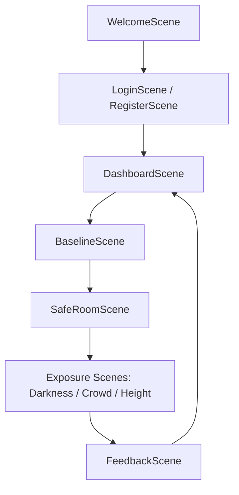

# PHOBIA RELIEF THERAPY IN VR
## Comprehensive Project Walkthrough & System Guide

This document is a complete, start-to-finish technical walkthrough of the **Phobia Relief Therapy** virtual reality application. It is designed to help FYP students, developers, and defense presenters understand the architecture, database integration, VR interactions, and script flows of the entire project.

---

## 1. Project Vision & Clinical Premise
This application is a **Virtual Reality Exposure Therapy (VRET)** tool designed for clinical cognitive-behavioral therapy. It assists patients in overcoming three common phobias by exposing them to controlled, simulated environments:
1.  **Nyctophobia (Fear of Darkness)**: Visualized progressively using `darkness_image.jpeg` (Stage 1), `darkness_image2.jpeg` (Stage 2), and `darkness_image3.jpeg` (Stage 3) to build tolerance over sequential 30-second windows.
2.  **Ochlophobia (Fear of Crowds)**: Visualized using `crowd_image.jpg.jpeg`.
3.  **Acrophobia (Fear of Heights)**: Visualized using `height_image.png`.

### Vitals-Driven Bio-feedback
A critical component of cognitive therapy is monitoring the user's physiological stress response. The application pairs with a **heart rate monitor** via Bluetooth to track the patient's beats per minute (BPM) in real time.
*   **Baseline Calibration**: Before exposure, the patient's resting heart rate is measured over a **20-second calibration window** in a calming environment.
*   **Exposure Tracking**: During a **30-second exposure session**, the application logs real-time heart rate fluctuations to see how the user reacts to Low, Medium, or High exposure levels.
*   **Data Integrity**: Session summaries (average BPM, max BPM, session duration, timestamp) are stored locally first and synced to a cloud database, allowing therapists to analyze progress over time.

---

## 2. Technology Stack & Key Frameworks
*   **Game Engine**: Unity (for 3D rendering, cross-platform compilation, and scene lifecycle management).
*   **VR Standard**: **OpenXR** & **XR Interaction Toolkit (XRI)** (drives headset tracking, spatial controllers, UI raycasting, and interaction events).
*   **Typography**: **TextMesh Pro** (renders crisp, scalable text in 3D world space).
*   **Cloud Backend**: **Supabase** (PostgreSQL relational database, user authentication APIs, and cloud logging storage).
*   **Local Backend**: **SQLite** (via the `SQLite4Unity3d` library wrapper, creating a local database `PhobiaReliefTherapy.db` to serve as a secure caching layer for offline use).
*   **Vitals Connectivity**: **Bluetooth Low Energy (BLE)** (detects and communicates with standard chest strap heart rate monitors like the Polar H10).

---

## 3. End-to-End User Experience & Scene Flow

The application executes a state-machine-like progression through 9 distinct scenes:



1.  **`WelcomeScene`**: The entry point presenting the application logo and a click-to-start action.
2.  **`LoginScene` / `RegisterScene`**: The user logs in or registers. The app communicates with Supabase, verifies credentials, caches the access token, and loads user profile details.
3.  **`DashboardScene`**: The main menu where the therapist/patient selects the desired phobia track (Darkness, Crowd, or Height).
4.  **`BaselineScene`**: A peaceful scene where the patient relaxes for 20 seconds. The app measures their resting BPM to establish a physiological baseline.
5.  **`SafeRoomScene`**: A transition room showing the baseline results. The user reviews their baseline vitals and confirms they are ready to enter the exposure stage.
6.  **`Exposure Scenes` (`DarknessScene` / `CrowdScene` / `HeightScene`)**: The patient is placed inside a 3D panoramic environment representing their phobia for 30 seconds. Real-time heart rate and gaze directions are logged.
7.  **`FeedbackScene`**: Summarizes the session results (average/peak heart rate, calibration comparison) and uploads the session log to the database. It then returns the user to the Dashboard.

---

## 4. Script Architecture (File-by-File Blueprint)

The code is modularly structured into sub-folders under `Assets/Scripts/`:

### A. Managers (`Assets/Scripts/Managers/`)
Controls the application's global lifecycles and subsystems:
*   [AuthManager.cs](file:///c:/Users/ahmad/PhobiaReliefTherapy/Assets/Scripts/Managers/AuthManager.cs): Coordinates authentication requests (login, registration, password recovery) with Supabase's REST endpoints and stores session tokens locally in Unity's secure `PlayerPrefs`.
*   [SensorManager.cs](file:///c:/Users/ahmad/PhobiaReliefTherapy/Assets/Scripts/Managers/SensorManager.cs): Manages BLE pairing with hardware heart rate sensors. If no physical sensor is present (e.g., in the Unity Editor), it fires up a **Mock Sensor Fallback** that simulates a resting heart rate of 70-80 BPM with slight natural fluctuations (±2 BPM), raising it during exposure by 15-25% to simulate stress.
*   [VRManager.cs](file:///c:/Users/ahmad/PhobiaReliefTherapy/Assets/Scripts/Managers/VRManager.cs): Detects if an active VR HMD is connected. It manages initialization toggles, switches the system to flat-screen fallback modes if no headset is connected, and tracks active controller bindings.
*   [SceneLoader.cs](file:///c:/Users/ahmad/PhobiaReliefTherapy/Assets/Scripts/Managers/SceneLoader.cs): A utility script that handles clean scene transitions, displaying progress overlays, and preventing memory leaks during scene loading.
*   [WelcomeScreenManager.cs](file:///c:/Users/ahmad/PhobiaReliefTherapy/Assets/Scripts/Managers/WelcomeScreenManager.cs): Handles simple transition logic on the welcome panel, redirecting to the login screen.

### B. Virtual Reality (`Assets/Scripts/VR/`)
Manages spatial coordinates, VR headsets, input actions, and spatial UI interaction:
*   [VRRigBuilder.cs](file:///c:/Users/ahmad/PhobiaReliefTherapy/Assets/Scripts/VR/VRRigBuilder.cs): Configures the VR Rig dynamically at runtime. It creates an `XROrigin`, attaches the camera, configures left/right hand controller nodes, adds laser-pointer rays for UI, sets comfort wrist angles (15° pitch), and implements the **Double-Height Camera Fix** by resetting floor offsets to `Y = 0f` to avoid stacked camera height glitches.
*   [VRMenuDragger.cs](file:///c:/Users/ahmad/PhobiaReliefTherapy/Assets/Scripts/VR/VRMenuDragger.cs): Enables world-space UI menus to be grabbed, moved, and rotated in 3D. It appends a `BoxCollider` to canvases at runtime. Grabbing the menu anchors it to the controller, and users can push/pull the menu distance using the thumbstick Y-axis (clamped between `0.5m` and `3.0m`) and rotate its yaw using the thumbstick X-axis.
*   [VRKeyboard.cs](file:///c:/Users/ahmad/PhobiaReliefTherapy/Assets/Scripts/VR/VRKeyboard.cs): A custom, code-generated virtual keyboard. It renders a complete key grid in world-space VR, captures laser clicks, handles character typing, Backspace, Enter, CapsLock, Shift, and password character masking (`*`), preventing rendering crashes associated with native OS virtual overlays.
*   [VRKeyboardTrigger.cs](file:///c:/Users/ahmad/PhobiaReliefTherapy/Assets/Scripts/VR/VRKeyboardTrigger.cs): Attaches to input fields. When a VR laser pointer clicks the field, it triggers the virtual keyboard to slide into view and redirects text inputs to that field.
*   [VRGazePointer.cs](file:///c:/Users/ahmad/PhobiaReliefTherapy/Assets/Scripts/VR/VRGazePointer.cs): Tracks the patient's head orientation and looks for specific vectors. Used in exposure scenes to monitor if a patient is actively looking at or away from the phobia triggers.

### C. Data Layer (`Assets/Scripts/Data/`)
Handles persistent storage and local/cloud synchronization:
*   [DatabaseManager.cs](file:///c:/Users/ahmad/PhobiaReliefTherapy/Assets/Scripts/Data/DatabaseManager.cs): Manages connections to the local SQLite database (`PhobiaReliefTherapy.db`) and cloud synchronization with Supabase. It maintains local tables for session statistics and uses background routines to sync cached records to the cloud when internet access is restored.
*   [UserData.cs](file:///c:/Users/ahmad/PhobiaReliefTherapy/Assets/Scripts/Data/UserData.cs): Model class representing the serializable user profile, authentication payload, and session log parameters.

### D. Therapy Logic (`Assets/Scripts/Therapy/`)
Coordinates the clinical steps:
*   [BaselineManager.cs](file:///c:/Users/ahmad/PhobiaReliefTherapy/Assets/Scripts/Therapy/BaselineManager.cs): Manages the 20-second vitals baseline calibration scene. It displays a peaceful, relaxing 360-degree environment and gathers initial heart rate samples.
*   [SafeRoomManager.cs](file:///c:/Users/ahmad/PhobiaReliefTherapy/Assets/Scripts/Therapy/SafeRoomManager.cs): Serves as the clinical safe transition room. Displays baseline statistics and prompts the patient for confirmation before beginning the selected exposure therapy session.
*   [DarknessManager.cs](file:///c:/Users/ahmad/PhobiaReliefTherapy/Assets/Scripts/Therapy/DarknessManager.cs): Manages the multi-stage progressive Nyctophobia exposure therapy. It loads three sequential panoramic textures into the skybox and 2D fallback background (30 seconds each) with "Stage X" text overlays.
*   [CrowdManager.cs](file:///c:/Users/ahmad/PhobiaReliefTherapy/Assets/Scripts/Therapy/CrowdManager.cs), [HeightManager.cs](file:///c:/Users/ahmad/PhobiaReliefTherapy/Assets/Scripts/Therapy/HeightManager.cs): These scripts manage the respective exposure environments. They load 360-degree panoramic textures into skyboxes, run the 30-second timer, log real-time heart rates, and handle flat-screen mouse panning fallback simulations in the editor.
*   [PhobiaSelectionManager.cs](file:///c:/Users/ahmad/PhobiaReliefTherapy/Assets/Scripts/Therapy/PhobiaSelectionManager.cs): Drives the dashboard selection panel UI, allowing users to choose the phobia track and exposure level (Low, Medium, High).

### E. Theme Engine (`Assets/Scripts/Theme/`)
Maintains clinical design consistency:
*   [ThemePreset.cs](file:///c:/Users/ahmad/PhobiaReliefTherapy/Assets/Scripts/Theme/ThemePreset.cs): ScriptableObject definition mapping style parameters such as colors, fonts, margins, and sizes.
*   [ThemeableUI.cs](file:///c:/Users/ahmad/PhobiaReliefTherapy/Assets/Scripts/Theme/ThemeableUI.cs): Attaches to individual UI elements (Buttons, Text, Input Fields, Panels) to define their styling category (e.g. `PrimaryButton`, `BodyText`).
*   [UIThemeAutoApply.cs](file:///c:/Users/ahmad/PhobiaReliefTherapy/Assets/Scripts/Theme/UIThemeAutoApply.cs): Scans active scenes on load, converts canvases to WorldSpace if VR is running, attaches [VRMenuDragger.cs](file:///c:/Users/ahmad/PhobiaReliefTherapy/Assets/Scripts/VR/VRMenuDragger.cs), and applies styling parameters from `ThemePreset` to all `ThemeableUI` elements.
*   [ThemeManager.cs](file:///c:/Users/ahmad/PhobiaReliefTherapy/Assets/Scripts/Theme/ThemeManager.cs): System singleton that allows switching UI themes dynamically (e.g., Clinical Blue to Dark Mode).

---

## 5. Critical Technical Deep Dives (For FYP Defenses)

### A. Dynamic VR Canvases and UI Scaling
A major issue in Unity VR development is making standard UI canvases legible and interactive.
1.  **WorldSpace Conversion**: Standard canvases render in screen overlay (which makes them invisible inside VR HMDs). The script converts the canvas render mode to `RenderMode.WorldSpace`.
2.  **Downscaling UI**: To make the UI readable, we downscale the canvas transform by a factor of **`0.001f`**. This scale ensures that 1920 pixels on the canvas translates to 1.92 meters wide in the virtual environment.
3.  **Graphic Raycasting**: The default `GraphicRaycaster` is replaced with the XR Interaction Toolkit's **`TrackedDeviceGraphicRaycaster`**. This allows the controller's laser-pointer ray (cast as a physical line with hit testing) to send standard hover and click events to the UI canvas.

### B. The 3D Panoramic Skybox System
To avoid rendering complex 3D meshes (which raises build file sizes and lowers performance on standalone headsets), the application uses **360-degree panoramic skybox textures**:
1.  **Texture Import**: High-resolution equirectangular textures are loaded.
2.  **Material Assignment**: A custom Unity Material is created using the **`Skybox/Panoramic`** shader, with the mapping set to *Latitude Longitude*.
3.  **Runtime Render**: The script assigns this material to `RenderSettings.skybox` on scene load.
4.  **Rotation Tracking**: Turn tracking is handled automatically. The camera's `TrackedPoseDriver` updates the view vector matching the headset. Since the skybox renders infinitely far away, looking around reveals different areas of the 360-degree texture, simulating a 3D environment.
5.  **Flat-Screen Fallback**: When testing in the Unity Editor without a VR headset, a flat canvas panel is displayed as a fallback, and holding the **Right Mouse Button** hides it, letting the developer rotate the camera view using Mouse X/Y movements to simulate headset turns.

### C. Relational SQL Database Schema (Supabase)
The backend database is structured to track users and therapy sessions securely. Because of these relationships, a relational (SQL) database is preferred:

```
[profiles] Table
  - id (UUID, Primary Key, references auth.users)
  - updated_at (Timestamp)
  - username (Text)
  - full_name (Text)

[sessions] Table
  - id (UUID, Primary Key)
  - user_id (UUID, Foreign Key referencing profiles.id)
  - phobia_type (Text: 'Darkness', 'Crowd', 'Height')
  - exposure_level (Text: 'Low', 'Medium', 'High')
  - duration (Float)
  - avg_bpm (Float)
  - peak_bpm (Float)
  - baseline_bpm (Float)
  - created_at (Timestamp)
```

### D. Offline SQLite Caching & Synchronization
To prevent data loss if a clinic's Wi-Fi drops during a session:
1.  **SQLite Log**: Upon session completion, the data is instantly written to the local SQLite database file `PhobiaReliefTherapy.db` on the VR headset's local storage path.
2.  **Supabase Upload**: The client then attempts to send the data to Supabase using a web request.
3.  **Retry Queue**: If the web request fails (due to a timeout or connection issue), the session log is marked as *unsynced* in SQLite.
4.  **Background Checker**: The `DatabaseManager` runs a background check that attempts to sync any unsynced local logs to Supabase once a stable internet connection is detected.

---

## 6. How to Set Up, Run, and Build the Project

### Opening in Unity
1.  Open the Unity Hub and click **Add**.
2.  Navigate to the `PhobiaReliefTherapy` folder and open the project in **Unity 2022.3 LTS** (or the version specified in the Project Version file).
3.  Ensure the active build platform in **File -> Build Settings** is set to **Android** (if building for Meta Quest standalone) or **PC, Mac & Linux Standalone** (if building for Oculus Link / PCVR).

### Local Mock Debugging (No VR Headset & No BLE Sensor)
1.  Open `Assets/Scenes/WelcomeScene.unity`.
2.  Press the **Play** button in the Unity Editor.
3.  Use your mouse to click buttons.
4.  To test keyboard input, click the fields and use the dynamic on-screen keyboard.
5.  In the baseline or exposure scenes, hold the **Right Mouse Button** and drag to simulate headset look-around.
6.  The application will automatically detect that no VR headset is connected, disable VR initialization, run in flat-screen mode, and run mock heart rate telemetry.

### Compiling and Deploying to Meta Quest
1.  Enable **Developer Mode** on your Meta Quest headset.
2.  Connect the headset to your PC via a USB-C link cable.
3.  In Unity, navigate to **File -> Build Settings**.
4.  Select **Android** and set the **Run Device** option to your detected Meta Quest headset.
5.  Click **Build and Run**. The APK will compile and automatically deploy to your Quest device.
6.  You can find the app on the Quest under the **Library -> Unknown Sources** category.
